<div align="center">
  <a href="https://github.com/Homebrew/homebrew-cask/pulls?q=is%3Apr+reviewed-by%3Akrehel">
    <picture>
      <source media="(prefers-reduced-motion: reduce) and (prefers-color-scheme: dark)" srcset="https://raw.githubusercontent.com/krehel/krehel/main/assets/portrait-still-dark.svg">
      <source media="(prefers-reduced-motion: reduce)" srcset="https://raw.githubusercontent.com/krehel/krehel/main/assets/portrait-still-light.svg">
      <source media="(prefers-color-scheme: dark)" srcset="https://raw.githubusercontent.com/krehel/krehel/main/assets/portrait-dark.svg">
      <source media="(prefers-color-scheme: light)" srcset="https://raw.githubusercontent.com/krehel/krehel/main/assets/portrait-light.svg">
      
    </picture>
  </a>
</div>

<p align="center">Every dot is a pull request I've reviewed. One ring a year, oldest at the centre.</p>

<br>

<p align="center">Hi, I'm Justin, one of Homebrew's Lead Maintainers. I became a maintainer in 2023 and a Lead Maintainer in 2025. These days I review casks and focus on making Homebrew faster and better on Linux.</p>

<br>

<details>
<summary><b>Tech specs</b></summary>

<br>

<div align="center">
  <a href="https://brew.sh">
    <picture>
      <source media="(prefers-color-scheme: dark)" srcset="https://raw.githubusercontent.com/krehel/krehel/main/assets/brew-info-dark.svg">
      <source media="(prefers-color-scheme: light)" srcset="https://raw.githubusercontent.com/krehel/krehel/main/assets/brew-info-light.svg">
      
    </picture>
  </a>
</div>

## `brew analytics`

Reviewing is now most of what I do.

<div align="center">
  <a href="https://github.com/Homebrew/homebrew-cask/pulls?q=is%3Apr+reviewed-by%3Akrehel">
    <picture>
      <source media="(prefers-color-scheme: dark)" srcset="https://raw.githubusercontent.com/krehel/krehel/main/assets/brew-analytics-dark.svg">
      <source media="(prefers-color-scheme: light)" srcset="https://raw.githubusercontent.com/krehel/krehel/main/assets/brew-analytics-light.svg">
      
    </picture>
  </a>
</div>

## `brew list --pinned`

The projects I work on most.

| Project | What I do there |
| :--- | :--- |
| [Homebrew/homebrew-cask](https://github.com/Homebrew/homebrew-cask) | Reviews, fixes and Linux support |
| [Homebrew/brew](https://github.com/Homebrew/brew) | Speed, Linux support, cask audits and RuboCops |
| [Homebrew/homebrew-core](https://github.com/Homebrew/homebrew-core) | Reviews and formula fixes |

Outside Homebrew, I made a [Tokyo Night theme for bb](https://github.com/krehel/bb-plugin-tokyo-night).

## `brew log krehel`

Some changes I'm pleased with.

| Change | Result |
| :--- | :--- |
| [Request headers when the body is unused](https://github.com/Homebrew/brew/pull/23528) | Audits check URLs without downloading them, up to 44× faster |
| [Fix `curl_version` memoisation](https://github.com/Homebrew/brew/pull/23651) | `curl -V` runs once instead of on every call, with 16× less overhead |
| [Reuse cached disk usage in `abv`](https://github.com/Homebrew/brew/pull/23632) | Size totals in installs, uninstalls and `brew info` are 1.6× faster |
| [Speed up linking and unlinking kegs](https://github.com/Homebrew/brew/pull/24332) | `brew link` is up to 1.6× faster, which also speeds up installs and uninstalls |
| [List formula versions using bash](https://github.com/Homebrew/brew/pull/24373) | `brew list --versions` answers without starting Ruby, which speeds up scripts |
| [Support font sharding in Homebrew/cask](https://github.com/Homebrew/brew/pull/17265) | Paved the way for the 2,600+ font casks now in homebrew-cask |

See [all my merged `brew` pull requests](https://github.com/Homebrew/brew/pulls?q=is%3Apr+is%3Amerged+author%3Akrehel).

## `brew fetch --os=linux krehel`

Making Homebrew faster and more reliable on Linux.

| Change | Result |
| :--- | :--- |
| [Bring 150+ casks to Linux](https://github.com/Homebrew/homebrew-cask/pulls?q=is%3Apr+is%3Amerged+author%3Akrehel+AppImage+in%3Atitle) | Apps that were macOS-only in Homebrew now install on Linux with `brew install --cask` |
| [Read ELF metadata without elftools](https://github.com/Homebrew/brew/pull/24423) | Reads ELF files 16× faster, which speeds up Linux installs |
| [Avoid needless ELF and linkage work on Linux](https://github.com/Homebrew/brew/pull/24392) | Skips needless work on each pour, so Linux installs are up to 1.4× faster |
| [Keep `-L` flags ahead of superenv paths](https://github.com/Homebrew/brew/pull/23821) | Fixed `brew update` breaking on Fedora when Homebrew's Ruby couldn't load |
| [Print cask cache paths for Linux platforms](https://github.com/Homebrew/brew/pull/23850) | `brew --cache --os=linux` now shows cask paths instead of nothing |
| [Handle casks without a version in a given OS](https://github.com/Homebrew/brew/pull/24096) | `brew cleanup` no longer crashes on Linux |

## `brew deps --tree krehel`

```text
krehel
├── ruby, shell, elixir, go, python
├── perl, terraform, zig
├── macos, fedora, gentoo
├── ghostty, neovim, zed, starship
└── lazygit, herdr, lilex, tokyonight
```

## `brew help`

- **Something broken in Homebrew?** Start with [Homebrew Discussions](https://github.com/orgs/Homebrew/discussions).
- **Want your app in Homebrew?** Read [Acceptable Casks](https://docs.brew.sh/Acceptable-Casks), then [How to Open a Homebrew Pull Request](https://docs.brew.sh/How-To-Open-a-Homebrew-Pull-Request).
- **Want to support the project?** [Sponsor Homebrew](https://github.com/sponsors/Homebrew).

</details>
